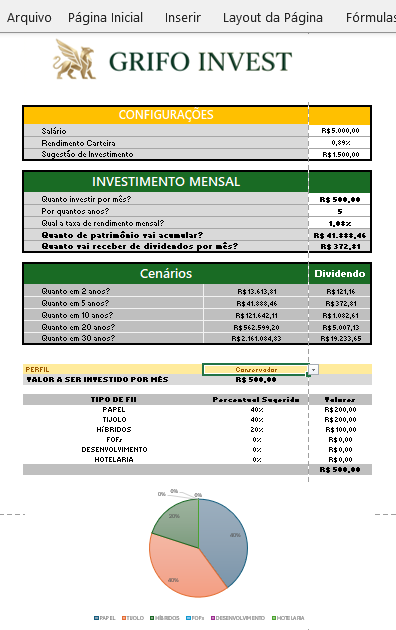
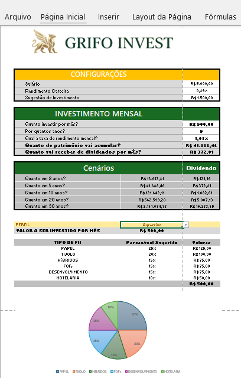

# Simulador de Investimento em FIIs

> Logo criado pelo autor com auxílio de ferramentas de IA.

Ferramenta em Excel para simular aportes mensais em fundos imobiliários, com divisão do investimento por perfil e previsão de dividendos. Qualquer pessoa pode usar a planilha sem conhecer fórmulas: basta preencher os campos e escolher o perfil.

## Perguntas que a ferramenta responde

Todas as respostas aparecem na aba `APP`:

1. Quanto investir por mês? (`D15`, campo preenchido pelo usuário)
2. Por quantos anos? (`D16`, campo preenchido pelo usuário)
3. Qual a taxa de rendimento mensal? (`D17`, campo preenchido pelo usuário)
4. Quanto de patrimônio vai acumular? (`D18`)
5. Quanto vai receber de dividendos por mês? (`D19`)

Também há uma tabela de cenários (linhas 22 a 26) com o patrimônio e os dividendos para 2, 5, 10, 20 e 30 anos.

## Sugestão de aplicação

A planilha sugere 30% do salário como valor a investir (`D12`). Essa sugestão é apenas informativa: o cálculo usa o aporte digitado em `D15`.

## Como a planilha funciona

**VF (FV)** calcula o patrimônio acumulado com juros compostos, considerando o aporte mensal, a taxa mensal e o prazo em meses. O aporte entra negativo na fórmula, por convenção do Excel, e o resultado sai positivo.

**PROCV (VLOOKUP)** busca o percentual de cada tipo de FII para o perfil escolhido. Como a busca precisa cruzar dois critérios (perfil e tipo de fundo), a aba `Planilha2` cria uma chave composta, formada pelo perfil, um hífen e o tipo de fundo, por exemplo `Agressivo-TIJOLO`. O PROCV procura essa chave e devolve o percentual correspondente.

**Dividendos** são calculados multiplicando o patrimônio acumulado pelo rendimento da carteira (`rendimento_carteira`).

## Intervalos nomeados

| Nome | Célula | Uso |
|---|---|---|
| `aporte` | APP!D15 | Valor mensal investido |
| `qtd_anos` | APP!D16 | Prazo em anos |
| `taxa_mensal` | APP!D17 | Rendimento mensal da simulação |
| `patrimonio` | APP!D18 | Patrimônio acumulado |
| `rendimento_carteira` | APP!D11 | Base para o cálculo de dividendos |
| `salario` | APP!D10 | Salário informado |
| `sugestao_investimento` | APP!D12 | 30% do salário (informativo) |

## Percentuais por perfil

| Tipo de FII | Conservador | Moderado | Agressivo |
|---|---|---|---|
| Papel | 40% | 25% | 25% |
| Tijolo | 40% | 35% | 20% |
| Híbridos | 20% | 20% | 15% |
| FOFs | 0% | 15% | 15% |
| Desenvolvimento | 0% | 5% | 15% |
| Hotelaria | 0% | 0% | 10% |
| **Total** | **100%** | **100%** | **100%** |

Os valores estão na aba `Planilha2`. Cada perfil soma 100%.

### Origem dos percentuais

Os percentuais foram definidos a partir de uma pesquisa pessoal, com apoio de ferramentas de IA, considerando os cenários de prazo e aporte apresentados. São valores de exemplo, não recomendação de investimento, e não foram validados por profissional certificado. Antes de usar em decisões reais, revise a alocação com dados atuais dos fundos e, se possível, com um consultor habilitado.

## Lógica dos perfis

### 1. Conservador
**Foco:** máxima segurança, previsibilidade e menor volatilidade patrimonial.

* **Tijolo (40%):** maior peso em imóveis físicos, para buscar renda de aluguel mais estável.
* **Papel (40%):** alocação forte em títulos de dívida imobiliária, de menor risco.
* **Híbridos (20%):** fundos mistos, para diversificação dentro de uma mesma cota.
* **FOFs, Desenvolvimento e Hotelaria (0%):** zerados para evitar dupla taxa de administração, risco de obras e oscilação do setor de turismo.

### 2. Moderado
**Foco:** equilíbrio entre geração recorrente de renda e valorização do capital.

* **Tijolo (35%):** principal base imobiliária física da carteira.
* **Papel (25%):** complemento de renda por meio de títulos de dívida.
* **Híbridos (20%):** flexibilidade entre crédito e ativos imobiliários.
* **FOFs (15%):** diversificação por meio da gestão de outros fundos.
* **Desenvolvimento (5%):** pequena fatia em projetos imobiliários em construção.
* **Hotelaria (0%):** zerada por maior sensibilidade econômica do setor.

### 3. Agressivo
**Foco:** maximizar o Dividend Yield e buscar ganho de capital expressivo, aceitando maior volatilidade e risco.

* **Papel (25%):** títulos de dívida de maior rentabilidade e maior risco de crédito.
* **Tijolo (20%):** imóveis físicos, com foco em oportunidades de recuperação.
* **Híbridos (15%) e FOFs (15%):** diversificação adicional, com foco em negociações abaixo do valor patrimonial.
* **Desenvolvimento (15%):** exposição a projetos em construção, com maior potencial de ganho e maior risco.
* **Hotelaria (10%):** exposição ao setor de turismo, com maior sensibilidade a ciclos econômicos.

## O que mudou em relação à ferramenta do Expert

A estrutura da planilha segue o modelo apresentado pelo Expert: as mesmas abas, as mesmas fórmulas de VF e PROCV, os mesmos intervalos nomeados e a mesma lista suspensa para o perfil. As mudanças foram:

* **Percentuais por perfil:** os valores foram redefinidos com base na pesquisa própria, diferentes dos utilizados no modelo original.
* **Valores de exemplo:** salário, aporte mensal e rendimento da carteira foram alterados.
* **Perfil padrão:** a planilha abre com o perfil Agressivo selecionado.
* **Rótulos:** ajustes de nomenclatura, como "HOTELARIA" no singular.
* **Limpeza:** células de teste usadas para validar o PROCV foram removidas.
* **Identidade visual:** inclusão de logo criado pelo autor.

## Como usar

1. Informe o salário e o aporte mensal.
2. Defina o prazo em anos e a taxa de rendimento mensal.
3. Escolha o perfil na lista suspensa em `C29`.
4. Veja o patrimônio acumulado, os dividendos mensais e a divisão do aporte entre os tipos de FII.

Para comparar perfis, mantenha a mesma simulação e troque apenas o perfil.

## Prints

**Perfil Conservador**



**Perfil Agressivo**



Os dois prints usam a mesma simulação (R$ 500 por mês, 5 anos e taxa de 1,08% ao mês). O patrimônio acumulado e os dividendos são iguais nos dois, e só a divisão do aporte muda com o perfil.

## Estrutura do repositório

```
simulador-fii/
├── README.md
├── planilha/
│   └── simulador-fii.xlsx
└── prints/
    ├── perfil-conservador.png
    └── perfil-agressivo.png
```